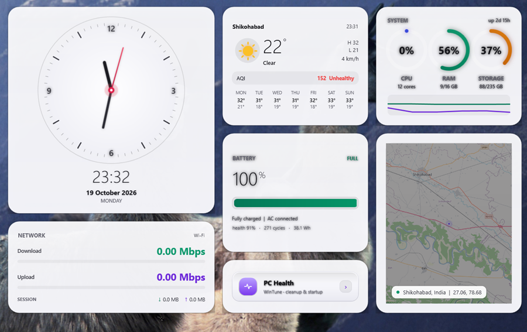

# DeskClock

[](#requirements)
[](#requirements)
[](LICENSE)

A lightweight desktop widget suite for Windows 11 — seven live WPF panels that sit on your desktop, always behind your windows, never in the way.



Current look: **Porcelain** — translucent white glass cards with dark, high-contrast typography and an asymmetric bento layout.

---

## ✨ Features

### 7 live widgets

| Widget | What it shows |
|---|---|
| 🕐 **Clock** | White analog dial with perfect concentric rings, numbers on the bezel, red second hand, digital time + full date |
| 📊 **System** | CPU / RAM / Storage rings, live CPU+RAM sparkline (last ~2 min), uptime |
| 🔋 **Battery** | Charge %, level bar, **charging wattage**, time to full, **battery health %**, cycle count, capacity |
| 🌤 **Weather** | Current temp, condition, high/low, wind, AQI, **7-day forecast** |
| 🌐 **Network** | Live download/upload speed, adapter name, session totals |
| 🗺 **Map** | GPS-based map of your current location with reverse-geocoded city |
| ⚙️ **PC Health** | One-click button that opens the built-in WinTune panel |

### Real data only — nothing is faked

| Value | Source |
|---|---|
| CPU / RAM | `Win32_PerfFormattedData_PerfOS_Processor`, `Win32_OperatingSystem` |
| Storage | `Win32_LogicalDisk` |
| Battery charge / rate | `root\wmi` → `BatteryStatus` (`Charging`, `ChargeRate`, `RemainingCapacity`) |
| Battery health | `BatteryFullChargedCapacity` ÷ `BatteryStaticData.DesignedCapacity` |
| Battery cycles | `root\wmi` → `BatteryCycleCount` |
| Weather | [Open-Meteo](https://open-meteo.com/) forecast API |
| Air quality | Open-Meteo Air Quality API (US AQI) |
| Network speed | `Get-NetAdapterStatistics` |
| Map tiles | OpenStreetMap |
| City name | Nominatim reverse geocoding |
| Location | Windows Geolocation API (`Windows.Devices.Geolocation`) |

If a source is unavailable, the widget says so (`AQI n/a`, `offline`) instead of inventing a number.

### Built for reliability

- **Single-process architecture** — all widgets run inside one PowerShell host via STA runspaces. Shared CLR + WPF assemblies keep RAM around **300 MB** instead of ~1.3 GB with separate processes.
- **Self-healing watchdog** — the tray process checks every 15 s. If the host dies it is restarted; if windows vanish the host is recycled.
- **Single-instance locks** — a mutex per widget type means duplicate windows can never appear.
- **Verify-and-retry launcher** — waits for each window to actually appear, retries up to 4 times.
- **Autostart with Windows** — optional Startup shortcut starts everything at login.
- **Safe stop** — the launcher never kills its own process tree.

### WinTune — PC health & cleanup (built in)

Open it from the tray menu → **PC Health & Cleanup**, or click the **PC Health** widget on the desktop.

| Tab | What it does |
|---|---|
| **Dashboard** | CPU / RAM / C: usage, uptime, top 12 processes by RAM |
| **Cleanup** | Scans User/Windows Temp, Windows Update cache, Chrome/Brave/Edge caches, npm cache and the Recycle Bin; shows reclaimable size; cleans the selected targets |
| **Startup** | Lists `HKCU\...\Run` entries and Startup-folder items; disables HKCU entries with an automatic JSON backup |
| **Battery** | Charge %, charging wattage, time to full, battery health, design vs full capacity, cycle count |

Everything is read from real sources — no placeholder numbers.

---

## 📦 Requirements

- Windows 10 / 11
- Windows PowerShell 5.1 (built in)
- Internet connection for weather, air quality and map tiles

No installation, no dependencies, no admin rights required.

---

## 🚀 Quick start

```powershell
git clone https://github.com/arpitsingh404/deskclock.git
cd deskclock

# start all widgets
powershell -ExecutionPolicy Bypass -File .\deskclock.ps1 -Action start

# make it start automatically at login
powershell -ExecutionPolicy Bypass -File .\deskclock.ps1 -Action autostart -State on
```

---

## 🎛 Commands

| Command | What it does |
|---|---|
| `-Action start` | Start the host (all widgets) and the tray |
| `-Action stop` | Stop all widgets |
| `-Action status` | Show what is running |
| `-Action reset` | Kill everything, clear saved positions, restart with the default layout |
| `-Action heal` | Start only what is missing |
| `-Action tray` | Start the tray icon only |
| `-Action autostart -State on\|off\|status` | Manage the Windows login shortcut |

### Tray menu

Right-click (or left-click) the tray icon:

- Show all widgets / Hide all widgets
- Restart + reset layout
- **PC Health & Cleanup** (WinTune)
- Auto-repair widgets (toggle)
- Start with Windows (toggle)
- Exit tray icon

---

## ⚙️ Configuration

### Theme

Edit `theme.json` to change the palette. The default is **Porcelain** (light):

```json
{
  "name": "Porcelain",
  "accent": "#6D28D9",
  "accent2": "#1D4ED8",
  "text": "#0B0B10",
  "muted": "#2E2E38",
  "dim": "#5C5C68",
  "ok": "#047857",
  "okSoft": "#059669",
  "warn": "#B45309",
  "warnSoft": "#D97706"
}
```

Restart the widgets after editing (`-Action reset`).

For a dark theme, use light-on-dark values:

```json
{
  "name": "Aurora",
  "accent": "#A78BFA",
  "accent2": "#60A5FA",
  "text": "#F8FAFC",
  "muted": "#CBD5E1",
  "dim": "#94A3B8",
  "ok": "#34D399",
  "okSoft": "#6EE7B7",
  "warn": "#FBBF24",
  "warnSoft": "#FDE68A"
}
```

> Note: the panel background colour lives in the shared glass block of `widget.ps1` / `extras.ps1`. The default build ships the light translucent-white panel.

### Location

The map widget resolves your location with the Windows Geolocation API, reverse-geocodes it, and caches the result so the weather widget shows the same city:

```
%APPDATA%\DeskClock_location.json
```

You can also set it manually:

```json
{
  "lat": 27.0573,
  "lon": 78.6841,
  "city": "Shikohabad",
  "region": "Uttar Pradesh",
  "country": "India",
  "cc": "IN"
}
```

### Widget positions

Window positions are stored per widget in `%APPDATA%\DeskClock_<type>.json`. Drag a widget where you want it, or run `-Action reset` to restore the default layout.

---

## 🧱 Architecture

```
deskclock.ps1          launcher: start / stop / status / reset / heal / tray / autostart
deskclock_host.ps1     single PowerShell process, one STA runspace per widget
widget.ps1             clock, stats, map, battery, PC Health button
extras.ps1             weather, network
wintune.ps1            PC health & cleanup panel (opened from the tray or the button)
tray.ps1               system-tray icon + auto-repair watchdog
themes.ps1             theme helper
theme.json             colour palette
```

### Default layout (asymmetric bento)

```
x=526              x=940              x=1236
┌───────────────┬──────────┬──────────┐
│               │ WEATHER  │ SYSTEM   │
│    CLOCK      │ 282×230  │ 282×230  │
│    400×400    ├──────────┼──────────┤
│               │ BATTERY  │          │
├───────────────┤ 282×230  │   MAP    │
│   NETWORK     ├──────────┤ 282×348  │
│   400×178     │PC HEALTH │          │
└───────────────┴──────────┴──────────┘
       bottom 610      bottom 610
```

All columns bottom-align at the same coordinate.

---

## 🎨 Design notes

- **Panels** — translucent white gradient (94–98 % opacity), 22 px radius, 1 px hairline border, soft 42 px shadow, top sheen.
- **Typography** — Segoe UI Variable; headers are small muted caps, values are large and dark. Key numbers use Segoe UI Light with tabular figures.
- **Clock** — the bezel, dial face and tick canvas are fixed square sizes so the rings stay perfectly concentric (an `Ellipse` left to stretch becomes an oval).
- **Battery** — reads `root\wmi` first because several laptops (ASUS, some Lenovo) report a wrong `BatteryStatus` in `Win32_Battery` while plugged in.
- **Map** — only GPS-derived locations are cached, so an IP-based fallback never overwrites an accurate one.

---

## 📈 Performance

| Metric | Value |
|---|---|
| Processes | 2 (host + tray) |
| RAM (working set) | ~300 MB host + ~100 MB tray |
| CPU (idle) | < 1 % |
| Widget refresh | clock 100 ms · stats 2 s · network 1 s · battery 15 s · weather 10 min · map 30 s |

---

## 🩺 Troubleshooting

| Symptom | Fix |
|---|---|
| No widgets appear | `deskclock.ps1 -Action status`, then `-Action heal` |
| Widgets disappeared after a while | The tray watchdog restores them within ~45 s. Make sure the tray is running (`-Action tray`). |
| Weather shows a different city | Windows Location Services may be off. Set `%APPDATA%\DeskClock_location.json` manually. |
| Battery says "not charging" while plugged in | Some laptops report a wrong `Win32_Battery.BatteryStatus`. This project reads `root\wmi` directly, which is reliable. |
| Text hard to read | Raise panel opacity in the glass block, or use darker `text` / `muted` / `dim` values in `theme.json`. |
| Clock rings look oval | The dial `Ellipse` elements must keep fixed `Width`/`Height`; if they stretch, they become ovals. |
| Console window flashes at login | The Startup shortcut uses `-WindowStyle Hidden`; check that it still points at `deskclock.ps1`. |

---

## 📄 License

MIT © 2026 Arpit Singh

- GitHub: [@arpitsingh404](https://github.com/arpitsingh404)
- Repository: [deskclock](https://github.com/arpitsingh404/deskclock)
